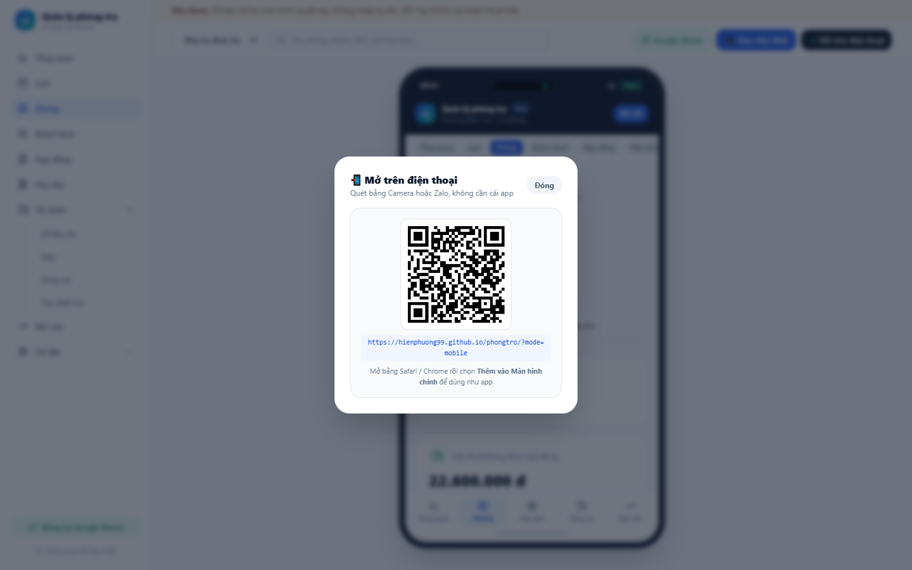
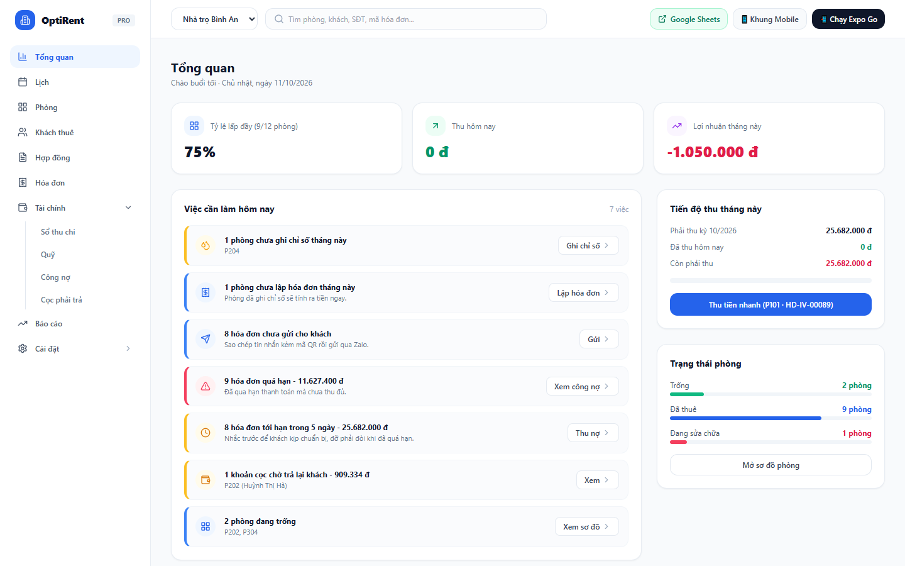
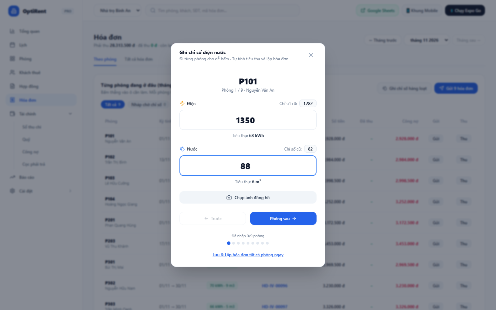
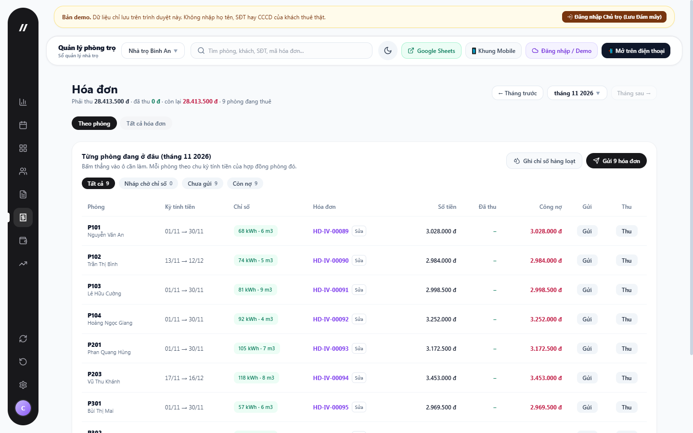
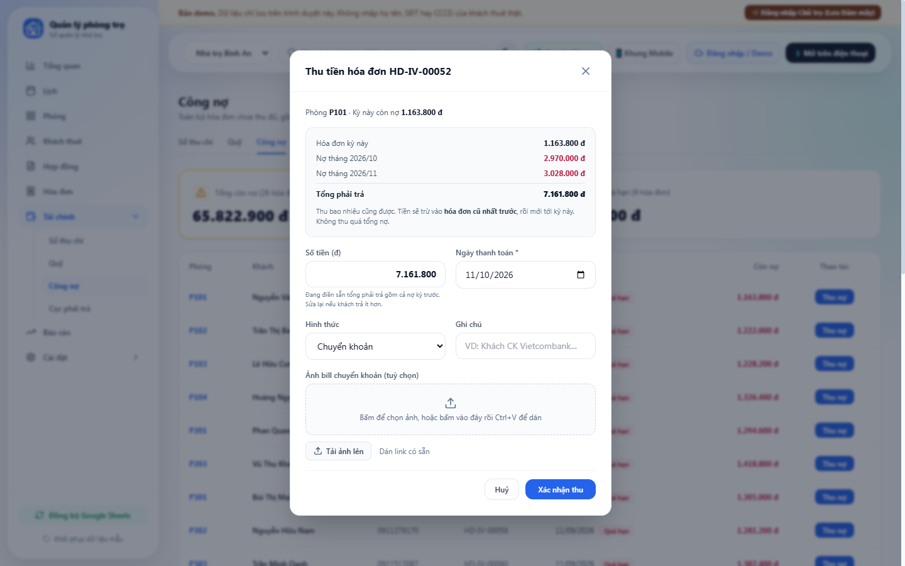
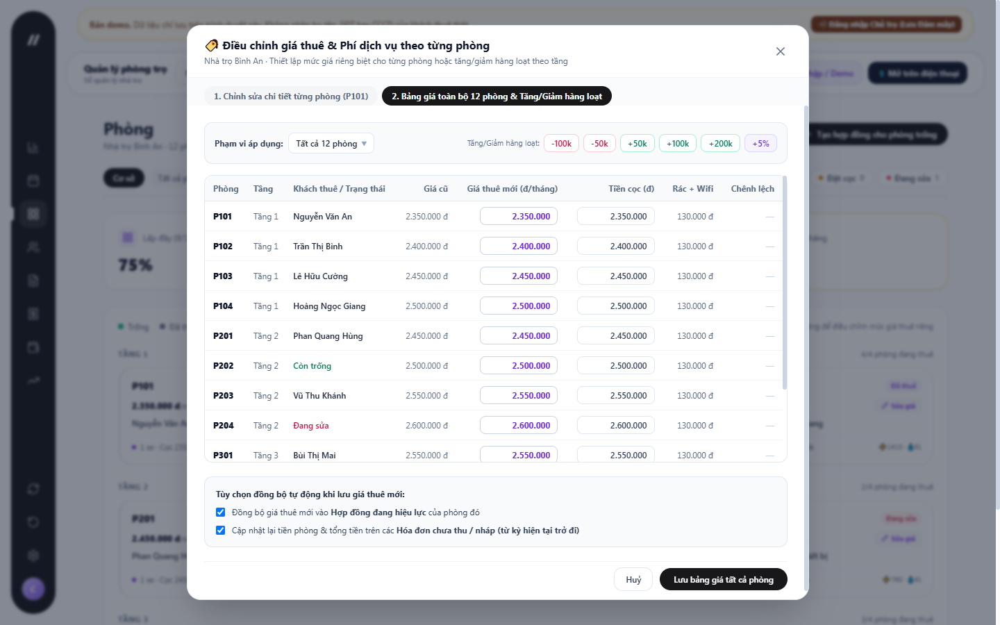
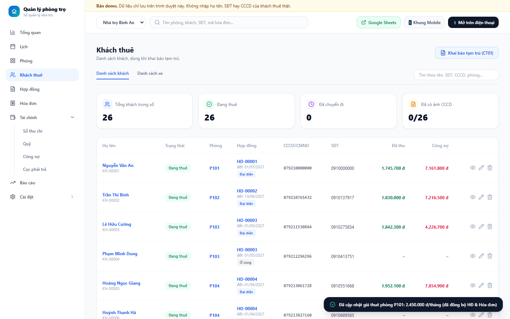
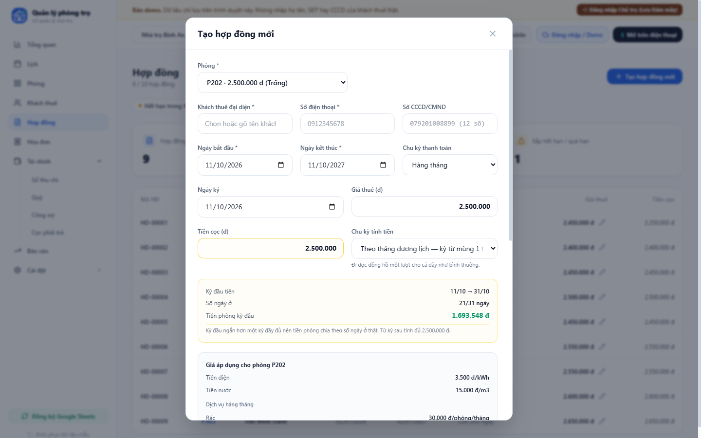
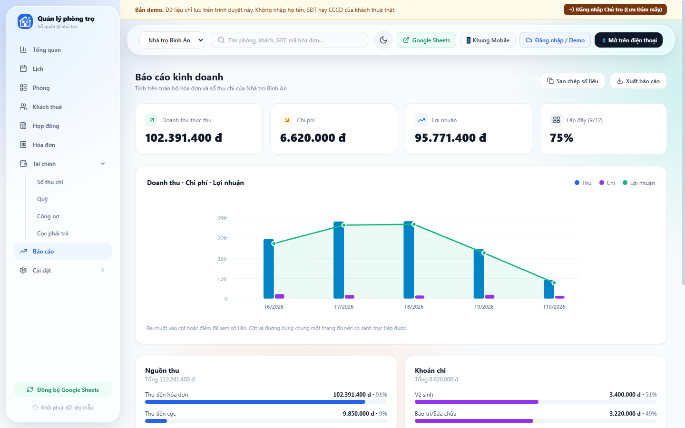

# Hướng dẫn sử dụng — Quản lý phòng trọ (bản demo)

Dành cho chủ trọ dùng thử và cho người mang bản demo đi phỏng vấn. Cập nhật 19/10/2026.

- Trên máy tính: https://hienphuong99.github.io/phongtro/
- Trên điện thoại: https://hienphuong99.github.io/phongtro/?mode=mobile

---

## 1. Trước khi bắt đầu: đây là bản demo

- **Dữ liệu là dữ liệu mẫu** của 2 cơ sở: *Nhà trọ Bình An* (12 phòng) và *Khu trọ An Phú*.
- **"Hôm nay" luôn là 11/10/2026.** Mọi hạn thu và số ngày còn lại của hợp đồng đều tính theo ngày này.
- **Dữ liệu chỉ lưu trong trình duyệt bạn đang dùng.** Mở bằng máy khác, trình duyệt khác hoặc tab ẩn danh sẽ thấy lại dữ liệu mẫu ban đầu. Xoá lịch sử trình duyệt là mất dữ liệu đã nhập.
- **Chưa có đăng nhập.** Đừng nhập số CCCD, số điện thoại hay số tài khoản thật của khách.
- Bấm thoải mái. Muốn làm lại từ đầu thì bấm **Khôi phục dữ liệu mẫu** ở menu bên trái (có hỏi xác nhận trước khi xoá).

---

## 2. Mở app

**Trên máy tính:** mở link máy tính ở trên bằng Chrome, Edge hoặc Safari.

**Trên điện thoại:**
1. Trên máy tính, bấm **📲 Mở trên điện thoại** ở góc phải trên cùng để hiện mã QR.
2. Quét mã bằng Camera hoặc Zalo.
3. Muốn dùng như một app: trong Safari bấm *Chia sẻ → Thêm vào MH chính*; trong Chrome bấm *⋮ → Thêm vào màn hình chính*.

Nút **📱 Khung Mobile** trên máy tính cho xem trước giao diện điện thoại ngay trên màn hình lớn.

---

## 3. Làm quen màn hình

- **Menu bên trái:** Tổng quan, Lịch, Phòng, Khách thuê, Hợp đồng, Hóa đơn, Tài chính (Sổ thu chi, Quỹ, Công nợ, Cọc phải trả), Báo cáo, Cài đặt.
- **Chọn cơ sở** ở ô trên cùng. Đổi cơ sở thì mọi màn hình chỉ hiện phòng, khách, hóa đơn và tiền của cơ sở đó.
- **Tổng quan** là nơi nên mở đầu tiên. Ở đây có:
  - Tỷ lệ lấp đầy, tiền thu trong ngày, lợi nhuận tháng.
  - **Việc cần làm hôm nay**: phòng chưa ghi chỉ số, hóa đơn chưa gửi, hóa đơn quá hạn, cọc cần trả lại, phòng trống. Mỗi dòng có nút đi thẳng tới việc đó.
  - Ba nút nhanh: **Ghi điện nước**, **Bảng giá phòng**, **Lập hợp đồng**.

---

## 4. Việc mỗi đầu tháng: ghi số → gửi phiếu → thu tiền

Đây là phần dùng nhiều nhất, làm theo đúng thứ tự dưới đây.

### 4.1 Ghi chỉ số điện nước

1. Vào **Hóa đơn → Ghi chỉ số hàng loạt** (hoặc **Tổng quan → Ghi điện nước**).
2. App đi lần lượt từng phòng. Mỗi phòng hiện chỉ số cũ; bạn nhập chỉ số mới, app tự tính số kWh và m³.
3. Có thể bấm **Chụp ảnh đồng hồ** để lưu ảnh làm bằng chứng.
4. Bấm **Phòng sau** / **Trước** để chuyển phòng. Dòng "Đã nhập x/9 phòng" cho biết còn bao nhiêu phòng.
5. Bấm **Lưu & Lập hóa đơn tất cả phòng ngay**. App tính tiền phòng, điện, nước, rác, internet, gửi xe và tạo hóa đơn cho từng phòng.

App không cho lưu khi chỉ số mới nhỏ hơn chỉ số cũ, để tránh gõ nhầm.

### 4.2 Gửi phiếu báo cho khách qua Zalo

1. Ở màn **Hóa đơn**, chọn tháng bằng **← Tháng trước / Tháng sau →**. Bấm bộ lọc **Chưa gửi** để chỉ xem phòng chưa nhận phiếu.
2. Bấm **Gửi** ở dòng của phòng. Hộp phiếu báo có hai tab:
   - **Ảnh hóa đơn**: phiếu đầy đủ kèm mã VietQR, đã điền sẵn số tiền và nội dung chuyển khoản.
   - **Tin nhắn Zalo**: tin nhắn soạn sẵn, cuối tin có **link mở mã QR**.
3. Chọn cách gửi:
   - **Chia sẻ** (trên điện thoại): mở bảng chia sẻ của máy, chọn Zalo rồi chọn khách.
   - **Sao chép tin nhắn**, rồi bấm **Mở Zalo 09xx…** để mở đúng cuộc trò chuyện với khách và dán vào.
   - **In**: dùng khi cần phiếu giấy.
4. Hóa đơn chỉ được đánh dấu "đã gửi" sau khi bạn **chia sẻ hoặc sao chép thành công**.

**Số tiền trên phiếu:** "TỔNG PHẢI TRẢ" bằng phần còn thiếu của kỳ này **cộng nợ các kỳ trước**. Nếu khách đã trả trước một phần, phiếu có dòng "Đã trả kỳ này" và chỉ đòi phần còn lại.

### 4.3 Thu tiền: tự trừ vào nợ cũ nhất trước

Có ba chỗ để mở hộp thu tiền:
- Nút **Thu** trên từng dòng hóa đơn.
- **Tài chính → Công nợ → Thu nợ**.
- **Tổng quan → Thu tiền nhanh**.

Cách điền:
1. Ô **Số tiền** điền sẵn tổng khách đang nợ, gồm cả các tháng trước. Khách trả bao nhiêu thì sửa lại đúng số đó.
2. Chọn **Ngày thanh toán**, **Hình thức** (chuyển khoản / tiền mặt). Ghi chú và ảnh bill chuyển khoản là tùy chọn.
3. Bấm **Xác nhận thu**.

App trừ tiền vào **hóa đơn cũ nhất trước** rồi mới tới tháng này. Ví dụ: khách nợ tháng 9 và 10, trả 5 triệu, thì app trả hết tháng 9, rồi tháng 10, phần còn lại mới vào tháng 11. Màn hình kết quả cho biết mỗi hóa đơn được trừ bao nhiêu. Mỗi khoản trừ thành một dòng trong Sổ thu chi.

App không cho thu nhiều hơn tổng nợ. Chưa có chức năng giữ tiền thừa làm tiền trả trước.

### 4.4 Kiểm tra cuối đợt thu

- **Tổng quan → Việc cần làm hôm nay**: còn bao nhiêu hóa đơn chưa gửi, bao nhiêu hóa đơn quá hạn.
- **Tài chính → Công nợ**: mọi hóa đơn chưa thu đủ của tất cả các tháng, có dán nhãn **Quá hạn**.

---

## 5. Phòng và giá thuê

- **Phòng** hiện sơ đồ theo tầng: phòng trống, đã thuê, sắp vào ở, đặt cọc, đang sửa. Bấm các ô trạng thái ở trên để lọc.
- Bấm vào một **phòng trống** để lập hợp đồng ngay cho phòng đó.
- **Sửa giá** trên từng phòng: đổi giá thuê, tiền cọc, phí rác, internet, số xe, trạng thái phòng.
- **Điều chỉnh giá thuê phòng** (hoặc **Tổng quan → Bảng giá phòng**), tab **Bảng giá toàn bộ phòng & Tăng/Giảm hàng loạt**: tăng hoặc giảm giá nhiều phòng cùng lúc, hợp với mùa tăng giá sau Tết.
- Khi lưu giá mới, có hai lựa chọn:
  - **Đồng bộ giá thuê mới vào Hợp đồng đang hiệu lực** của phòng đó.
  - **Cập nhật lại tiền phòng & tổng tiền trên các hóa đơn chưa thu / nháp.** Hóa đơn kỳ đầu đang tính theo số ngày ở vẫn giữ đúng tỷ lệ ngày ở, không bị đổi thành nguyên tháng.

---

## 6. Khách thuê, xe và khai báo tạm trú

- **Khách thuê → Danh sách khách**: họ tên, phòng, hợp đồng, vai trò (đại diện / ở cùng), CCCD, SĐT, tiền đã thu và còn nợ của phòng.
- **Danh sách xe**: biển số, chủ xe, phòng.
- Ô **tìm kiếm** dùng cho cả hai tab: gõ tên, SĐT, CCCD, số phòng hoặc biển số. Gõ không dấu cũng được; biển số gõ có hay không có dấu gạch đều được.
- **Khai báo tạm trú (CT01)**: app gom sẵn họ tên, phòng, CCCD, SĐT, quê quán, hạn tạm trú của mọi người đang ở. Bấm **Sao chép danh sách** hoặc **Xuất file Excel / CSV** để nộp trên Cổng Dịch vụ công hoặc in cho Công an phường.
- Xoá khách: app hỏi xác nhận trước khi xoá.

---

## 7. Hợp đồng

1. Bấm **Tạo hợp đồng mới**, hoặc bấm vào một phòng trống ở màn Phòng.
2. Điền họ tên khách và SĐT (10 số, bắt đầu bằng 0). CCCD có thể bổ sung sau.
3. Chọn **Ngày bắt đầu**, **Ngày kết thúc**, **Ngày ký** bằng bộ chọn ngày. Ngày kết thúc phải sau ngày bắt đầu.
4. Chọn **Chu kỳ tính tiền**:
   - **Theo tháng dương lịch**: kỳ từ mùng 1 tới cuối tháng. Tháng đầu tính theo số ngày ở thật. Ví dụ vào ở 11/10 thì tính 21/31 ngày.
   - **Theo ngày vào ở**: tròn tháng kể từ ngày nhận phòng. Tháng đầu tính nguyên tháng.
5. Chọn tình trạng tiền cọc:
   - **Vừa nhận hôm nay**: ghi một khoản "Thu tiền cọc" vào sổ.
   - **Đã nhận từ trước khi dùng phần mềm**: không ghi sổ, tránh tính nhầm vào doanh thu tháng này.
   - **Chưa nhận**: hợp đồng hiện cảnh báo chưa thu cọc.
6. Bấm **Tạo hợp đồng**. App tự đổi phòng sang "Đã thuê", thêm khách vào danh sách và **tạo luôn hóa đơn kỳ đầu**.

Các bộ lọc ở đầu màn Hợp đồng: **Hết hạn trong 60 ngày**, **Còn nợ**, **Còn hiệu lực**, **Đã kết thúc**, **Đã thanh lý**.

---

## 8. Tài chính, Báo cáo, Lịch

**Tài chính**
- **Sổ thu chi**: mọi khoản thu tiền phòng, tiền cọc và khoản chi.
  - **Ghi phiếu chi mới** hỏi nội dung và số tiền.
  - Bản demo ghi khoản chi vào hạng mục *Bảo trì/Sửa chữa*, hình thức *tiền mặt*, ngày 11/10/2026.
- **Quỹ**: số dư ngân hàng và tiền mặt, tính bằng thu trừ chi theo từng hình thức trong sổ thu chi. **Chưa có số dư đầu kỳ**, nên quỹ tiền mặt có thể âm nếu chỉ toàn khoản chi tiền mặt.
- **Công nợ**: mọi hóa đơn chưa thu đủ, kèm nút **Thu nợ**.
- **Cọc phải trả**: tiền cọc đang giữ hộ khách, và các khoản cọc tới lúc phải trả lại (khách đã dọn đi). Chuyển khoản trả khách xong thì bấm **Đã chuyển trả**: app ghi một khoản chi "Hoàn tiền cọc".

**Báo cáo**
- Thực thu (lấy từ sổ thu chi), chi phí, lợi nhuận, tỷ lệ lấp đầy.
- Biểu đồ thu – chi – lợi nhuận theo tháng: rê chuột vào cột để xem số tiền.
- Nguồn thu, khoản chi theo hạng mục, phòng thu tốt nhất, phòng đang nợ nhiều.
- **Sao chép số liệu** (dán vào Zalo hoặc ghi chú) và **Xuất báo cáo** (file CSV mở bằng Excel).
- Báo cáo tính trên toàn bộ dữ liệu của cơ sở đang chọn, **chưa lọc được theo ngày / tháng / năm**.

**Lịch**: ngày ghi chỉ số, hạn thu tiền, ngày chốt kỳ của từng phòng tính theo ngày vào ở, hợp đồng sắp hết hạn.

---

## 9. Kịch bản demo 5 phút (cho buổi phỏng vấn)

Mục đích là cho chủ trọ **thấy** cái họ mất thời gian nhất, không phải đi hết mọi màn hình. Trước buổi gặp, bấm **Khôi phục dữ liệu mẫu** để số liệu sạch.

1. **Tổng quan (30 giây):** "Mở app ra là biết hôm nay phải làm gì." Chỉ vào mục *Việc cần làm hôm nay*.
2. **Ghi chỉ số (1 phút):** Hóa đơn → Ghi chỉ số hàng loạt, nhập 2–3 phòng, bấm *Lưu & Lập hóa đơn*. "Ghi xong là có hóa đơn, không phải bấm máy tính."
3. **Gửi phiếu (1 phút):** bấm *Gửi* một phòng, mở tab *Ảnh hóa đơn* cho thấy mã VietQR. Trên điện thoại thì bấm *Chia sẻ* sang Zalo. "Khách quét là đúng số tiền, đúng nội dung."
4. **Khách trả gộp hoặc trả thiếu (1,5 phút):** Tổng quan → *Thu tiền nhanh*, sửa số tiền thành một số lẻ (ví dụ 5.000.000), bấm xác nhận. Cho xem màn kết quả trừ tháng cũ trước. "Không phải nhớ ai còn nợ tháng nào."
5. **Tăng giá sau Tết (1 phút):** Phòng → *Điều chỉnh giá thuê phòng* → tab hàng loạt, tăng 100k cho một tầng, bật đồng bộ hợp đồng.
6. Dừng lại, chuyển sang bộ câu hỏi phỏng vấn (mục 11 của [kế hoạch](KE-HOACH-KINH-DOANH.md)). **Không chào bán trong buổi phỏng vấn.**

Không nên demo: Lịch, Quỹ, Đồng bộ Google Sheets, `mobile-expo`.

---

## 10. Cài đặt và đồng bộ Google Sheets

**Đơn giá và tài khoản nhận tiền** (riêng cho từng cơ sở):
- **Giá điện**: nếu cao hơn 3.460 đ/kWh, app hiện cảnh báo về NĐ 133/2026. Các khoản điện dùng chung, bơm nước, vệ sinh nên ghi thành phí dịch vụ riêng trong hợp đồng.
- **Giá nước.**
- **Ngân hàng** và **Số tài khoản**: dùng để tạo mã VietQR trên phiếu báo.

**Đồng bộ Google Sheets** (chỉ dành cho chủ dự án):
1. Mở file Google Sheets → menu **🏠 Quản lý phòng trọ → 🔑 Tạo / xem mã đồng bộ**.
2. Dán mã vào ô **Mã đồng bộ (SYNC_TOKEN)** ở trang Cài đặt. Mã chỉ lưu trên trình duyệt này; thiếu mã thì Apps Script từ chối đọc/ghi.
3. Bấm **Đồng bộ ngay lên Google Sheets**. App ghi 7 trang tính: Phòng, Khách thuê, Xe, Hợp đồng, Hóa đơn, Sổ thu chi, Cài đặt.

Đồng bộ hiện là **sao lưu một chiều** từ app lên Sheets, không đọc ngược về.

---

## 11. Giới hạn của bản demo và câu hỏi thường gặp

| Câu hỏi | Trả lời |
|---|---|
| Sao ngày hôm nay vẫn là 11/10/2026? | Bản demo cố định ngày để dữ liệu mẫu khớp. Sẽ theo ngày thật từ tháng 11/2026. |
| Mở trên máy khác không thấy dữ liệu tôi nhập? | Dữ liệu chỉ nằm trong trình duyệt đã nhập. Đăng nhập và lưu trên máy chủ sẽ có từ tháng 11/2026. |
| Bấm "Chia sẻ" mà không thấy Zalo? | Trên điện thoại, bảng chia sẻ liệt kê Zalo nếu máy đã cài Zalo. Trên máy tính, tuỳ trình duyệt, nút này mở bảng chia sẻ của Windows / macOS hoặc chỉ sao chép tin nhắn; khi đó bạn dán vào Zalo PC. |
| "Thu hôm nay — Khớp VietQR" có tự đọc tài khoản ngân hàng không? | Chưa. Con số này là tổng các khoản thu (tiền phòng, tiền cọc) đã ghi vào sổ trong ngày. Khách bấm "Tôi đã chuyển" để bạn xác nhận 1 chạm là kế hoạch từ tháng 12/2026. |
| Khách trả dư thì sao? | Bản demo không cho thu quá tổng nợ. Phần dư tạm thời ghi tay ở ô ghi chú. |
| Có app trên App Store / CH Play không? | Chưa và năm đầu chưa làm. Dùng link `?mode=mobile` rồi thêm vào màn hình chính. Thư mục `mobile-expo` trong mã nguồn đã ngừng phát triển. |
| Dữ liệu của tôi có bị chia sẻ cho ai không? | Bản demo không gửi dữ liệu đi đâu, trừ khi chủ dự án bấm đồng bộ Google Sheets. Bản chính thức sẽ có nút tải toàn bộ dữ liệu ra Excel và xoá sạch trên máy chủ. |
